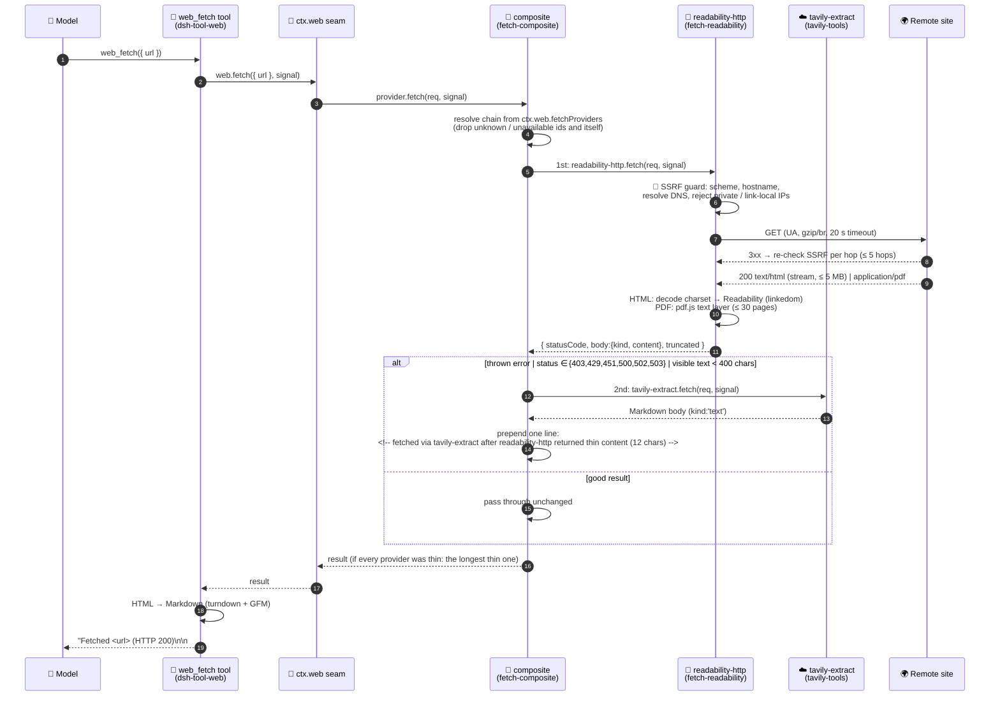
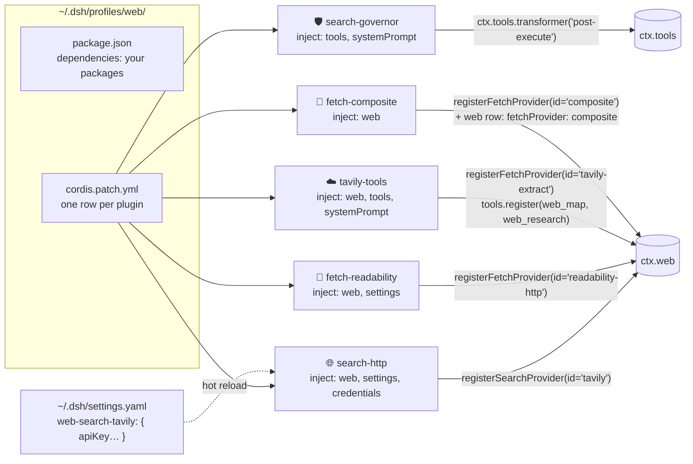

# dsh-web-search

Web search and page-fetch plugins for [DeepSeek Harness (DSH)](https://github.com/deepseek-ai), built around one goal: **let the model use the web without burning the context window.**

Seven independently installable DSH plugins live in this monorepo:

| Package | Kind | What it does |
| --- | --- | --- |
| `@baoson/dsh-web-search-governor` | tool hooks (`tools/execute`, `tools/post-execute`) | Shapes `web_search` results (dedupe, trim, cap), caches repeated queries, flags rephrased near-duplicate queries, keeps a per-session token ledger and enforces a per-session search budget. Zero extra tokens. |
| `@baoson/dsh-web-search-http` | search provider | Generic HTTP search provider with pluggable backends: **Tavily**, **Brave**, **Exa**, **Serper**, **Jina**, **SearXNG** (self-hosted, key-less). Registers under the backend name (`searchProvider: tavily`). |
| `@baoson/dsh-web-fetch-readability` | fetch provider (`readability-http`) | Fills DSH's missing `web_fetch` provider. SSRF-safe downloader + Readability article extraction so the model gets the article, not the nav bar. Also extracts the text layer of PDFs (`pdfjs-dist`). |
| `@baoson/dsh-web-tavily-tools` | fetch provider (`tavily-extract`) + tools `web_map`, `web_research` | Tavily's non-search endpoints: hosted extraction (JS-rendered pages, PDFs, anti-bot sites), site URL maps, and delegated multi-source research reports. One API key for all three. |
| `@baoson/dsh-web-fetch-composite` | fetch provider (`composite`) | Chains other fetch providers: `readability-http → tavily-extract`. Falls back on a thrown error, a 403-class status, or thin text (< 400 visible chars), so the paid extractor is only used when the free one failed. **The default active fetch provider.** |
| `@baoson/dsh-web-provider-selector` | host API + Web GUI settings page | "Web providers" settings section: see every registered search/fetch provider, switch the active one live (no restart), configure API keys, add a mainstream backend from a curated list. |
| `@baoson/dsh-image-retention` | `llm/stream` hook | Sibling token-saver, not web-specific: keeps only the last N images per model request, replacing older ones with a text placeholder (session log and GUI history untouched). |

They can be used together or on their own. The governor works with *any* search provider, including DSH's built-in one.

## Quick start

Requires Node ≥ 22, [pnpm](https://pnpm.io/installation) and `dsh` on your PATH (`npm i -g @deepseek-ai/dsh`).

```powershell
git clone https://github.com/SongBaoChenAlex/dsh-web-search
cd dsh-web-search
pwsh scripts/install-dsh.ps1        # Windows
bash scripts/install-dsh.sh         # macOS / Linux
```

The script runs `pnpm install` and mounts the recommended set (governor, search-http, fetch-readability, tavily-tools, fetch-composite, provider-selector) into the `web` profile. Then restart DSH and enter your search API key under **Settings → Web providers** in the Web GUI.

- `-All` / `--all` installs every package; `-Profile cli` / `--profile cli` targets another profile.
- Update later with `git pull && pnpm install` — plugins are path-linked, nothing to re-add.
- Full options and manual install: see [Installation](#installation).

---

## Table of contents

0. [Quick start](#quick-start)
1. [Why this exists](#why-this-exists)
2. [How it runs — the request path](#how-it-runs--the-request-path)
3. [Search providers: a taxonomy](#search-providers-a-taxonomy)
4. [Fetch providers: a taxonomy](#fetch-providers-a-taxonomy)
5. [Search addiction and how we treat it](#search-addiction-and-how-we-treat-it)
6. [Token budget: where the tokens actually go](#token-budget-where-the-tokens-actually-go)
7. [Installation](#installation)
8. [Configuration reference](#configuration-reference)
9. [Package details](#package-details)
10. [Development](#development)
11. [Limitations and roadmap](#limitations-and-roadmap)

---

## Why this exists

DSH ships with a `web_search` tool and a `web_fetch` tool (`@deepseek-ai/dsh-tool-web`). Out of the box:

- `web_search` is backed by `@deepseek-ai/dsh-web-search-deepseek`: it calls a **second model** (`deepseek-v4-flash` via the Anthropic-compatible Messages API) with a server-side web search tool, and relays that model's answer plus sources. You pay for the inner model *and* the outer one, and you cannot control how many pages it reads.
- Result snippets are passed to the main model **verbatim, with no length cap** (only the number of sources is capped, default 8).
- `web_fetch` exists but is **disabled** (`fetch: false`) and **no fetch provider is installed**, so it cannot work even when enabled.
- The web seam (`@deepseek-ai/dsh-web`) is deliberately pluggable: `ctx.web.registerSearchProvider()` / `ctx.web.registerFetchProvider()`.

This repo plugs those gaps while keeping every official package untouched.

---

## How it runs — the request path

### Search: what actually happens when the model calls `web_search`

```mermaid
sequenceDiagram
    autonumber
    participant M as 🧠 Model
    participant A as 🤖 Agent loop<br/>(dsh-agent)
    participant H as 🛡️ Governor<br/>tools/execute hook
    participant T as 🔧 web_search tool<br/>(dsh-tool-web)
    participant W as 🔌 ctx.web seam<br/>(dsh-web)
    participant P as 🌐 Provider<br/>(tavily | brave | exa | serper | jina | searxng | deepseek-official)
    participant G as 🛡️ Governor<br/>tools/post-execute hook

    M->>A: tool_call web_search({ query: "…" })
    A->>H: tools/execute(exec)
    alt query seen before in this session
        H-->>A: cached result (no network, 0 ms)
    else rephrased near-duplicate (Jaccard ≥ 0.5) in mode "block"
        H-->>A: the earlier cached result, or a near-duplicate notice
    else budget exhausted (10 / session)
        H-->>A: notice "search budget used up — reason from what you have"
    else
        H->>T: next() → tool.execute(args)
        T->>W: web.search({ query, maxResults: 8 })
        W->>W: resolve provider: web.searchProviderId<br/>(set by config or the selector UI)
        W->>P: provider.search(req, signal)
        P->>P: resolve API key (credentials → env)
        P-->>W: { content?, sources[], truncated }
        W-->>T: sources capped to maxResults
        T-->>H: ToolExecutionResult { value, content }
        H->>H: store in query cache, budget += 1
        H-->>A: result
    end
    A->>G: tools/post-execute(exec, result)
    G->>G: shape value: dedupe URLs, strip utm_*,<br/>snippet ≤ 300 chars, content ≤ 1500, ≤ 5 sources;<br/>prepend near-duplicate note (mode "notice");<br/>ledger += raw/shaped tokens, one log line
    G-->>A: { kind:'accept', value } → re-rendered by the tool's own render()
    A-->>M: tool_result (compact text) appended to context
```

Step by step, with where the tokens go:

| Step | Who | What happens | Tokens into the model's context |
| --- | --- | --- | --- |
| 1 | Model | Emits a `web_search` tool call. | ~20–40 (the call itself) |
| 2–4 | Governor (`tools/execute`) | Looks the normalized query up in the per-session cache; compares the query against the session's history for a rephrased near-duplicate; checks the budget. Either short-circuits (**no network**) or hands over to the tool. | 0 |
| 5–6 | `dsh-tool-web` | Validates args, calls `ctx.web.search` with `maxResults` 8 and a 60 s timeout. | 0 |
| 7 | `dsh-web` | Picks the provider: the configured id (`searchProvider` / selector UI), else the single available one, else `WEB_PROVIDER_AMBIGUOUS`. | 0 |
| 8–10 | Provider (`search-http`) | Resolves the key (DSH credentials store → launch env), POSTs/GETs the backend (Tavily, Brave, Exa, Serper, Jina, SearXNG), maps JSON → `{ content?, sources[], truncated }`. | 0 |
| 11–13 | Governor (`tools/execute`, after `next()`) | Caches the raw result, increments the budget. | 0 |
| 14–16 | Governor (`tools/post-execute`) | Shapes the value: fewer, shorter sources. Returns `{kind:'accept', value}` so the official renderer and the GUI's result card still apply. Updates the per-session ledger and logs `raw≈N tok → M tok`. | 0 |
| 17 | Agent loop | Renders the shaped value to text and appends it as the `tool_result`. | **~400–900** (vs ~1 500–3 000 unshaped) |

Everything in the middle is free; the only tokens that matter are the ones in step 17 — and that number is what the governor controls. The same shaped text is what the model reasons over on its next turn, so a smaller step 17 also means a cheaper *every subsequent turn* in that session.

**Which code runs where**

```
ctx.on('tools/execute')      ─┐
ctx.on('tools/post-execute')  ├─ search-governor  (host-level hooks; see every preset's tool calls)
ctx.systemPrompt.section()   ─┘
ctx.web.registerSearchProvider() ── search-http   (one row per backend; id = backend)
ctx.web.registerFetchProvider()  ── fetch-readability (readability-http) / tavily-tools (tavily-extract)
                                    / fetch-composite (composite — chains the two above)
ctx.tools.register()             ── tavily-tools   (web_map, web_research)
ctx.web.searchProviderId         ── provider-selector writes this live + persists to settings.yaml
ctx.web.fetchProviderId          ── same; default now `composite`
ctx.on('llm/stream')             ── image-retention (prepend; drops all but the last N images per request)
```

### Fetch

The active fetch provider in the shipped profile is **`composite`**: it does not download anything itself but runs the registered providers in a chain, local first.



The decision the composite makes per provider in the chain:

```
for provider in chain:                      (default: readability-http → tavily-extract)
   result = provider.fetch(url)
   ├─ throws            → next  (fallbackOnError; aborts always propagate as WEB_ABORTED)
   ├─ status in list    → next  (fallbackOnStatus: 403 429 451 500 502 503)
   ├─ visible text < 400→ remember as "thin", next  (minTextChars; tags stripped for html)
   └─ otherwise         → return it (+ notice line if anything was skipped before)
all thin   → return the LONGEST thin result (not the last), notice "(all providers thin)"
all failed → WEB_PROVIDER_ERROR listing every provider's reason
```

The notice is a single line (`<!-- … -->` for `kind:'html'`, `[…]` for `kind:'text'`) so the transcript shows which provider actually served the page; `notice: false` disables it. The composite never contacts the network itself and has no SSRF logic of its own — the chained providers keep theirs.

**Division of labour** (dictated by `dsh-web`'s contract):

| Responsibility | Who |
| --- | --- |
| URL validation, SSRF, redirects, size/time limits, content-type handling | **fetch provider (this repo)** — `readability-http` |
| Fallback between providers, provenance notice | `composite` |
| HTML → Markdown conversion | `dsh-tool-web` (official) |
| Final output cap (`fetchMaxOutputChars`, default 200 000) | `dsh-tool-web` (official) |
| Spilling huge tool results to disk (> 50 KB) | `dsh-spill-policy` (official) |

Because the official tool slices the HTML *before* converting, the cleaner the HTML our provider returns, the less likely truncation lands in the middle of the article body.

### Plugin wiring (how DSH loads these)



Every plugin is a plain [cordis](https://github.com/cordiverse/cordis) plugin: `export const name`, `inject`, `Config` (schemastery), `apply(ctx, config)`. Registration is effect-scoped, so disabling the row in YAML unregisters cleanly.

---

## Search providers: a taxonomy

Not all "web search APIs" return the same thing. Which class you pick determines how many follow-up fetches the model needs — and therefore your token bill.

### ① Classic search-engine APIs — *results for humans*

**Examples:** Bing Web Search, Google Custom Search, Brave Search API, Serper / SerpAPI (Google proxies).

- **Returns:** title + URL + a 150–300 char snippet.
- **Pros:** fast, cheap (Brave ≈ $3–5 per 1 000 queries), authoritative ranking.
- **Cons:** low information density. The model almost always has to `web_fetch` afterwards, so one "search" really costs 1 search + N fetches.
- **Good for:** "find *the* page", not "answer the question".

### ② LLM-native search APIs — *the provider already read the pages*

**Examples:** **Tavily**, Exa, Perplexity Sonar, Jina Search, You.com.

- **Returns:** a synthesized `answer` plus, per result, an **extracted content passage** (Tavily: `content`, optionally `raw_content` for the full page), often with relevance scores.
- **Pros:** one call usually gives the model enough to answer; most follow-up fetches disappear. You control volume with request parameters (`max_results`, `search_depth`, `include_answer`).
- **Cons:** pricier (Tavily ≈ $8 per 1 000, 1 000 free/month), you depend on their extraction quality.
- **Exa** is the outlier: neural / semantic retrieval ("find pages like this one") rather than keyword search.
- **Good for:** agent workflows. This is what `search-http` targets.

### ③ Model-embedded search — *search is a tool of another model*

**Examples:** **DSH's default `deepseek-official`** (flash model + `web_search_20250305`), OpenAI Responses `web_search`, Anthropic server-side web search, Gemini Grounding.

- **Returns:** an answer written by the inner model + citations.
- **Pros:** zero setup, already summarized.
- **Cons:** **double billing** (search + inner model input/output tokens), highest latency (an extra generation round), least control — you can set `max_tokens` / `max_uses`, but not how many pages it reads or what it keeps.
- **Good for:** a no-config default experience.

### ④ Self-hosted / meta search

**Examples:** SearXNG, a self-hosted engine proxy.

- Free, no key, private; but you operate it, and results are class-① snippets anyway.

### What this means for this repo

- DSH today = ③. The governor tames it from downstream without changing it.
- Tavily = ②. The governor still applies (it only looks at result shape), but its snippet cap should be looser, because Tavily's `content` *is* the useful part. Default per-provider override: `tavily → snippet ≤ 800`.
- `WebSearchSource` only has `url / title / snippet / publishedAt`. Tavily's `content → snippet`, `answer → content`, scores are dropped. The contract fits.

### One provider, five verbs: Tavily's endpoints and what we do with each

A class-② provider is more than a search box. Tavily exposes five endpoints; think of them as a ladder from "give me pointers" to "give me the finished answer" — each rung does more work for you, costs more credits, and returns more tokens.

```
            input                         output
search      a question           ──►  N ranked results + passages (+ optional answer)
extract     1..N known URLs      ──►  clean text / markdown of those pages
map         one site root        ──►  list of URLs on that site (no content)
crawl       one site root        ──►  URLs + their extracted content
research    a research question  ──►  a cited report (multi-step, agentic)
```

| Endpoint | Context cost | Credit cost | In this repo | Notes |
| --- | --- | --- | --- | --- |
| `search` | medium — passages, not meta snippets | 1 (basic) / 2 (advanced) | `search-http` → provider `tavily` | `answer → content`, `content → snippet`; `raw_content` off |
| `extract` | **high** — this *is* fetch | ~1 per 5 URLs | `tavily-tools` → fetch provider `tavily-extract` | Server-side extraction handles JS-rendered pages, PDFs, anti-bot sites; sends the URL to a third party. Alternative to local `readability-http` |
| `map` | very low — ~10 tokens per URL | low | `tavily-tools` → tool `web_map` | "Map the docs site, then fetch the 2 right pages" beats repeated searching |
| `crawl` | **extreme** — map × extract | high | — (deliberately) | A batch/indexing primitive; not something a model should trigger inside a chat turn |
| `research` | low for *your* context, high on *their* bill | highest | `tavily-tools` → tool `web_research` (POST `/research` → poll `GET /research/{id}`; budget 2/session; answer ≤ 6 000 chars) | Class ③ behaviour moved server-side: compact report, no control over what was read — hence the hard budget and the EXPENSIVE warning in the tool description |

The one-line summary for the token question: **`search` and `map` are cheap in context; `extract` and `crawl` are where context dies; `research` moves the cost from your context to your invoice.** The governor philosophy — hard budget + shaping + guidance — applies to all five, just with different numbers (`web_map` ships with a budget of 5 per session; `tavily-extract` is capped at 20 000 chars like `readability-http`).

Choosing a fetch provider:

| | `readability-http` (local) | `tavily-extract` (remote) |
| --- | --- | --- |
| Cost | free | credits |
| Privacy | URL never leaves your machine | URL sent to Tavily |
| JS-rendered pages (SPAs) | ✗ gets the empty shell | ✓ |
| PDF | ✗ "unsupported" note | ✓ |
| Anti-bot / Cloudflare pages | ✗ usually 403 | mostly ✓ |
| SSRF protection | DNS-resolved, per-hop | not needed (Tavily cannot reach your LAN) |
| Page-chrome removal | ✓ Readability keeps only the article | partial — `basic` depth keeps nav/"Sign in" links (measured on a GitHub page: 5 673 chars, first 300 all chrome); `advanced` is cleaner but 2× credits |
| Latency (measured) | 0.3–2 s | 1.2 s (extract), 2.6 s (map) |

Default is `readability-http`; switch per profile with `- id: web` → `config: { fetchProvider: tavily-extract }` or live via the provider selector.

---

## Fetch providers: a taxonomy

`web_search` answers *which pages* are relevant (URLs + snippets). `web_fetch` answers *what one page actually says*. A **fetch provider** is the implementation behind `web_fetch`: DSH's `ctx.web` fixes the contract — `{ url } → { statusCode, body: { kind: 'html' | 'text', content }, truncated }` — and the provider decides who downloads, how the page is cleaned, and therefore how many tokens the model pays.

Three properties determine that token bill:

1. **Can it get the page at all?** JavaScript-rendered SPAs, anti-bot walls (Cloudflare), PDFs, paywalls.
2. **How clean is the extraction?** A typical article is 100–300 KB of HTML and 3–8 KB of actual prose. Navigation, cookie banners, comment widgets and "related posts" are pure token waste — and the official tool slices *before* converting to Markdown, so dirty HTML risks truncating the body while keeping the chrome.
3. **Where does it run?** Locally (free, private, no rate limits) or on a third-party service (the URL and content transit their servers; per-call billing).

### The five families

| Family | Examples | How it works | Strengths | Weaknesses |
| --- | --- | --- | --- | --- |
| **① Local HTTP + readability extraction** | this repo's `readability-http`; DSH's own `tool-web` fetch path | local `fetch()` → charset decode → Readability-style article extraction → trimmed HTML | free, private, 0.3–2 s, **cleanest body text**, SSRF-guarded, reads the PDF text layer | no JS execution (SPAs return an empty shell), blocked by anti-bot pages, scanned image-only PDFs yield no text |
| **② Hosted extraction APIs** | this repo's `tavily-extract`; [Jina Reader](https://jina.ai/reader) (`r.jina.ai/<url>`); [Firecrawl](https://firecrawl.dev) `/scrape`; Exa `/contents` | POST the URL to a service; it renders, extracts and returns Markdown/text | passes anti-bot walls, executes JS, reads PDFs, batch-friendly | per-call credits; URL + content leave your machine; cleaning quality varies (Tavily `basic` kept GitHub's nav chrome in our test) |
| **③ Headless browser** | Playwright / Puppeteer, [Browserless](https://browserless.io), Crawlee | drive a real Chromium, take the rendered DOM | renders anything, can click/scroll/log in | heavy (hundreds of MB), slow (seconds), raw DOM still needs step-① cleaning afterwards — it is a *downloader*, not an *extractor* |
| **④ Content riding on search** | Tavily `include_raw_content`, Exa `contents.text`, Brave `extra_snippets` | the search call itself returns page bodies | saves one round-trip | uncontrollable: every result carries a body, which is exactly how a 8-result search becomes 40 k tokens — the governor exists to cut this |
| **⑤ Caches and archives** | [Wayback Machine](https://web.archive.org) (`web.archive.org/web/<ts>/<url>`), Common Crawl | serve a stored snapshot | dead links still readable; stable citations | possibly stale; coverage gaps; archive HTML still needs ①-style cleaning |

### How this repo combines them: three fetch providers

This repo registers **three** fetch providers in `ctx.web.fetchProviders`. Two do real work; the third decides which of the two to use.

| Provider id | Package | Family | Runs | Cost | Handles | Fails on |
| --- | --- | --- | --- | --- | --- | --- |
| `readability-http` | `fetch-readability` | ① local | your machine | free | static HTML (Readability article extraction), plain text / JSON / Markdown, **PDF text layer** (pdfjs-dist, ≤ 30 pages) | JS-rendered SPAs (empty shell), anti-bot walls (403/429), scanned image-only PDFs |
| `tavily-extract` | `tavily-tools` | ② hosted | Tavily's servers | ~1 credit per 5 URLs | JS rendering, anti-bot sites, PDFs incl. OCR-less scans handled server-side, paywall-lite pages | sends URL + content to a third party; cleaning quality varies by site |
| `composite` | `fetch-composite` | — (orchestrator) | your machine | only what its members cost | **chains the two above**: readability first, Tavily only when readability visibly failed | nothing by itself; if no member is registered/available it throws `WEB_PROVIDER_ERROR` |

**`composite` is the default active provider** (`web.fetchProvider: composite` in the shipped profile patch). Its decision flow per `web_fetch(url)`:

```
web_fetch(url)
 └─ composite
     ├─ 1. readability-http  (① local, free)
     │     ├─ threw (network / SSRF / decode)      → fall back       [fallbackOnError: true]
     │     ├─ statusCode ∈ {403,429,451,500,502,503} → fall back     [fallbackOnStatus]
     │     ├─ visible text < 400 chars ("thin")    → fall back       [minTextChars]
     │     └─ otherwise                            → RETURN as-is (no notice, zero overhead)
     └─ 2. tavily-extract    (② hosted, credits)
           ├─ good                                 → RETURN, prefixed with one line
           │                                         <!-- fetched via tavily-extract after readability-http returned thin (120 chars) -->
           └─ also thin                            → RETURN the LONGEST of the attempts (never the last one blindly)
```

Why an orchestrator instead of just picking one:

- ~90 % of pages are static articles where the local extractor is both free and *cleaner* than hosted services — so it must go first.
- The remaining 10 % (SPAs, Cloudflare, PDFs the local parser cannot read) used to cost a wasted tool call, a wasted turn and the model "deciding" to retry; the composite makes that fallback deterministic and invisible to the model.
- The one-line provenance notice keeps the transcript honest: you can see when credits were spent and why.
- Providers are looked up lazily per call, so plugin load order does not matter and you can switch members live from the **Web providers** page (the fetch table there lists all three; `composite` shows as active).

Family ③ is deliberately *not* shipped: a headless browser is the right tool for interactive tasks, which is a different plugin (and a different threat model) from "read this article cheaply". Family ④ is disabled in our Tavily adapter on purpose; family ⑤ is a reasonable future fallback for dead links.

> **Rule of thumb for the model** (also in the governor's prompt section): fetch only when a snippet is not enough. With `composite` active the model no longer needs to choose a provider; it calls `web_fetch` once and gets the best of the two.

---

## Search addiction and how we treat it

**Search addiction** (a.k.a. *search looping* / *over-searching*) is the failure mode where an agent keeps issuing searches instead of converging on an answer. Typical shapes:

- Re-searching the same thing with synonyms: *"how to configure X"* → *"X configuration"* → *"X setup guide"*.
- Finding the right URL, **not reading it**, and instead searching a more specific question hoping the snippet contains the answer.
- Opening a fresh search for every sub-question rather than reading the pages already on hand.
- Retrying forever on a poor result instead of concluding "not found".

**Why it is a token problem, not just a latency problem.** Every search result (DSH default: 8 sources + a synthesized answer) stays in the context. Ten searches ≈ 15–25 K tokens of low-density text, and they push earlier, genuinely useful content out of the compaction window. With a class-③ provider each search is additionally a billed inner-model call.

**Three layers, used together** (any one alone is leaky):

| Layer | Mechanism | Type | Where |
| --- | --- | --- | --- |
| **Shaping** | snippet / answer length caps, source cap, dedupe, tracking-param stripping | reduces volume per call | governor, post-execute |
| **Budget** | hard per-session cap (default 10). Past the cap the result is *replaced* with a notice, not an error | hard constraint on call count | governor, post-execute |
| **Guidance** | system-prompt section (below) | soft constraint on behaviour | governor, `systemPrompt.section` |

### The system-prompt section the governor registers

Placed immediately after DSH's own `tool:web_search` section (order 110). Can be disabled with `guidance: false`.

> **Using web search responsibly.** Before searching, check whether an earlier search result or fetched page in this conversation already answers the question. Do not repeat a search with rephrased or synonymous wording. When a result looks relevant but the snippet is insufficient, use `web_fetch` on that URL instead of searching again. Prefer one well-formed query over several narrow ones. Searches in this session are limited to a fixed budget; when it is exhausted the tool returns a notice and you must proceed with what you already have, stating clearly what could not be verified.

---

## Token budget: where the tokens actually go

Rough numbers for one task, main model only (inner-model cost of class-③ providers excluded):

| Action | Stock DSH | With this repo |
| --- | --- | --- |
| One `web_search` | 8 sources × uncapped snippet + answer ≈ 1.5–4 K tokens | 5 sources × ≤ 300 chars + answer ≤ 1 500 chars ≈ 0.6–1 K tokens (Tavily: ≤ 800-char snippets ≈ 1.2–1.6 K, but fewer fetches needed) |
| One `web_fetch` of an article page | *not available* (would be full-page markdown, often 30–150 K chars before the 50 KB spill kicks in) | Readability body, ≤ 20 000 chars ≈ 5–6 K tokens |
| 10 searches in a session | 15–40 K tokens | 6–10 K tokens, then the budget stops further calls |

Nothing in this repo adds tokens. Every stage only removes or caps.

---

## Installation

> Requires a DSH profile (default `web`) at `~/.dsh/profiles/web/`. Set `DSH_HOME` if yours differs.

> Prerequisites: Node ≥ 22, [pnpm](https://pnpm.io/installation), and `dsh` on your PATH (`npm i -g @deepseek-ai/dsh`).

### Option A — one command (recommended)

```powershell
git clone https://github.com/SongBaoChenAlex/dsh-web-search
cd dsh-web-search
pwsh scripts/install-dsh.ps1          # Windows / PowerShell
# or
bash scripts/install-dsh.sh           # macOS / Linux
```

This runs `pnpm install` and mounts the recommended set — governor, search-http, fetch-readability, tavily-tools, fetch-composite, provider-selector — into the `web` profile. Options:

| Flag | Effect |
| --- | --- |
| `-All` / `--all` | also install `image-retention` and `demo-command` |
| `-Profile cli` / `--profile cli` | target another DSH profile |
| `-Packages a,b` / positional `a b` | install only the named packages |
| `-SkipInstall` / `SKIP_INSTALL=1` | skip `pnpm install` |

Then restart DSH and open **Settings → Web providers** in the Web GUI to enter your search API key (Tavily, Brave, …).

**Updating:** `git pull && pnpm install`. Plugins are path-linked to this checkout, so there is nothing to re-add. Don't move or delete the directory while the plugins are mounted.

### Option B — pick packages by hand

```powershell
git clone https://github.com/SongBaoChenAlex/dsh-web-search
cd dsh-web-search
pnpm install

dsh plugin --profile web add ./packages/search-governor
dsh plugin --profile web add ./packages/search-http
dsh plugin --profile web add ./packages/fetch-readability
```

### Option C — from a registry

Not published yet. The packages are registry-ready (`@baoson/*`, `publishConfig.access: public`); once they are released, `dsh plugin --profile web add @baoson/dsh-web-search-governor` etc. will work without a clone.

### Mount the plugins

Each package ships a `cordis.patch.yml` bundle patch, so `dsh plugin add` mounts the row automatically. To change defaults, override the row by `id` in `~/.dsh/profiles/web/cordis.patch.yml` (or `~/.dsh/cordis.patch.yml` for all profiles):

```yaml
# Governor — works with any search provider (row id comes from its bundle patch)
- id: web-search-governor
  config:
    maxSources: 5
    snippetMaxChars: 300
    contentMaxChars: 1500
    budgetPerSession: 10
    guidance: true
    activeProvider: tavily            # which providerOverrides entry applies
    providerOverrides:
      tavily: { snippetMaxChars: 800 }

# Tavily search provider (registers as id "tavily")
- id: web-search-tavily
  config:
    apiKeyEnv: TAVILY_API_KEY

# Fetch provider (registers as id "readability-http")
- id: web-fetch-readability
  config:
    maxOutputChars: 20000

# Tell the web seam which search provider to use. The base composition pins
# deepseek-official; with tavily also registered and no explicit choice you get
# WEB_PROVIDER_AMBIGUOUS. (fetchProvider is already set by the fetch bundle.)
- id: web
  config:
    searchProvider: tavily
```

### Enable `web_fetch` (one extra step)

The official `tool-web` row ships with `fetch: false`. Where you flip it depends on the profile:

- **Headless / CLI profiles** — the row lives in the profile composition; add to `cordis.patch.yml`:
  ```yaml
  - id: tool-web
    config: { fetch: true }
  ```
- **Web GUI profile** — `dsh-web-app` disables the profile-level `tool-web` row and each **agent preset** remounts it. Shipped presets are read-only, so create your own: copy `<dsh install>/config/agent-presets/standard/` to `~/.dsh/.agent-presets/standard-fetch/`, edit `agent.cordis.yml` so the `tool-web` row reads `fetch: true`, give it a distinct `name` in `preset.yml`, then select that preset in the GUI.

### Credentials

Either environment variable (`TAVILY_API_KEY`) or `~/.dsh/settings.yaml` (hot-reloaded, same pattern as the official `web-search-deepseek:` section):

```yaml
web-search-tavily:
  apiKey: tvly-xxxxxxxx
```

### Verify

Refresh the DSH Web GUI and ask the model to:

1. Search something → result shows ≤ 5 sources with short snippets; the UI card shows provider `tavily`.
2. Search 11 times → the 11th returns the budget notice.
3. `web_fetch` a real article URL → Markdown body starting with `# <title>`, under 20 000 chars.
4. `web_fetch http://127.0.0.1:3080/` → rejected by the SSRF guard.

---

## Configuration reference

### `@baoson/dsh-web-search-governor`

| Key | Default | Notes |
| --- | --- | --- |
| `maxSources` | `5` | Sources kept after dedupe |
| `snippetMaxChars` | `300` | Per-source snippet cap |
| `contentMaxChars` | `1500` | Cap for the provider's synthesized answer |
| `budgetPerSession` | `10` | `0` disables the budget |
| `budgetNotice` | built-in text | Returned instead of results once exhausted |
| `stripTrackingParams` | `true` | Removes `utm_*`, `fbclid`, `gclid`, … |
| `guidance` | `true` | Register the system-prompt section |
| `providerOverrides` | `{ tavily: { snippetMaxChars: 800 } }` | Per-provider-id overrides of the caps above |

### `@baoson/dsh-web-search-http`

| Key | Default | Notes |
| --- | --- | --- |
| `backend` | `tavily` | `tavily` \| `brave` \| `exa`; also becomes the provider id |
| `apiKey` | – | Secret; prefer `apiKeyEnv` |
| `apiKeyEnv` | backend default (`TAVILY_API_KEY`, `BRAVE_SEARCH_API_KEY`, `EXA_API_KEY`) | Resolved via DSH credentials service, then launch env |
| `baseURL` | adapter default | Override endpoint |
| `timeoutMs` | `20000` | |
| `maxResults` | `5` | |
| `tavily.searchDepth` | `basic` | `advanced` costs 2× |
| `tavily.includeAnswer` | `true` | |
| `tavily.includeRawContent` | `false` | Full pages are `web_fetch`'s job |
| `brave.country` / `brave.searchLang` / `brave.safesearch` / `brave.freshness` | `""` / `""` / `moderate` / `""` | Brave query modifiers |
| `exa.type` | `auto` | `auto` \| `neural` \| `keyword` \| `fast` |
| `exa.highlightsPerResult` / `exa.highlightSentences` | `2` / `3` | Extracted passages mapped to `snippet` |

To run two backends at once, mount the package twice with different `id`s and `backend`s; each registers its own provider id, and the selector (or `searchProvider`) picks between them.

### `@baoson/dsh-web-fetch-readability`

| Key | Default | Notes |
| --- | --- | --- |
| `maxOutputChars` | `20000` | Body cap; adds a `[truncated: N of M chars]` trailer |
| `maxBodyBytes` | `5242880` | 5 MB download ceiling, stream aborted beyond |
| `timeoutMs` | `20000` | Below the tool's 30 s so errors are ours, not a kill |
| `maxRedirects` | `5` | Each hop re-validated |
| `userAgent` | `dsh-web-fetch/<version>` | |
| `allowPrivate` | `false` | **Debug only.** Permits loopback / RFC1918 targets |
| `readability` | `true` | `false` → always use the cleaned full page |
| `allowedContentTypes` | `text/*`, `application/json`, `application/xml`, `application/xhtml+xml` | Others → `kind:'text'` with an "unsupported" note |

---

## Package details

### search-governor

Two hooks on the host `ctx.tools` registry, both filtered to top-level `web_search` calls:

- `tools/execute` (around-dispatch) — checks the per-session **cache** (same normalized query → previous result, no network) and the **budget**; when exhausted it returns the notice *without* running the tool.
- `tools/post-execute` — **shapes** the structured value (dedupe, strip tracking params, caps) and hands it back as `{ kind:'accept', value }`, so the official tool's own renderer and UI card still apply.

Pure functions (`shape.js`, `budget.js`, `cache.js`) do the work; `index.js` only wires them in and registers the system-prompt section. Session key = `exec.agent.session.header.id`.

### search-http

```
lib/
  index.js          plugin: pick adapter by `backend`, register provider with id = backend
  adapter.js        interface SearchAdapter { defaultBaseURL; buildRequest(req, opts); parseResponse(json) → WebSearchResult }
  adapters/tavily.js
```

Adding a backend = one new file under `adapters/` plus one line in the registry. Credential resolution, timeouts, abort handling and `WebError` mapping are shared.

### fetch-readability

**What it is.** The backend for DSH's `web_fetch` tool. A search result only gives the model a URL and a one-line snippet; to actually *read* the page the model has to call `web_fetch(url)`. Stock DSH ships that tool but no implementation behind it (no provider installed, tool disabled), so out of the box the model cannot read web pages at all. This package fills that gap — and because it is the model that chooses which URL to fetch, it does two things stock DSH deliberately refused to do without:

1. **Security (SSRF guard).** Fetching whatever URL a model produces is dangerous: it could point at `http://127.0.0.1:3080` (this very GUI), a cloud metadata endpoint (`169.254.169.254`), or an internal service. The provider resolves the hostname **after DNS** and rejects loopback, RFC 1918, link-local, CGNAT, multicast and IPv6-local targets, and re-runs that check on **every redirect hop** (so a public URL that 302s to an internal one is also refused). Embedded credentials and non-http(s) schemes are rejected too. `allowPrivate: true` exists only for local debugging.
2. **Token reduction (Readability).** A full web page is mostly chrome — navigation, footer, sidebars, cookie banners, scripts, JSON-LD. The provider runs Mozilla's Readability (the same algorithm as Firefox Reader View, via `linkedom`) to keep only the article body, then caps the result at 20 000 characters. On the test fixture this cut **25 048 → 6 123 chars (−76 %)**; the saving grows with how much chrome a page carries. When Readability decides a page is not an article (docs index, table-heavy pages), it falls back to a cleaned full page with scripts/styles/nav/footer/aside stripped.

Everything else the `dsh-web` contract assigns to the provider is here as well: 5 MB streaming body cap, 20 s deadline for the whole redirect chain, charset detection (header → BOM → `<meta charset>` sniff), and content-type routing — HTML goes through extraction, text/JSON/XML pass through as `kind:'text'`, PDFs and binaries return a short "unsupported" note instead of garbage. Non-2xx responses are returned as results with their status code, never thrown, so the model can reason about a 404.

```
lib/
  index.js     plugin: register provider id "readability-http"
  ssrf.js      isBlockedHostname(), isPrivateAddress(), assertSafeUrl(url)  (DNS-resolved)
  download.js  fetch with limits, redirect loop with per-hop SSRF, streaming byte cap
  decode.js    charset from header / BOM / <meta> sniff → TextDecoder
  extract.js   Readability (via linkedom) → fallback cleaner; prepend <h1>; cap + trailer
```

---

## Development

```powershell
pnpm install
pnpm test          # vitest; no real network — local http.createServer fixtures
pnpm smoke            # scripts/smoke.js — manual, hits the real network
```

Workspace layout:

```
packages/
  shared/             internal, not published: settings, credentials, http, text helpers
  search-governor/
  search-http/
  fetch-readability/
scripts/smoke.js
```

---

## Limitations and roadmap

- **No fetch pagination.** `WebFetchRequest` is `{ url }` only, so an `offset` parameter cannot be added from a provider. Needs a change in `dsh-tool-web` / `dsh-web` upstream.
- **No PDF.** `application/pdf` returns an "unsupported" note. Candidate for v2.
- **More search backends** (Bing, Serper, SearXNG, Jina) are one file each under `search-http/lib/adapters/`; the selector's "Add a provider" list reads from the same catalog.

See [`plan.md`](./plan.md) for milestones, parallel tracks and acceptance criteria.
